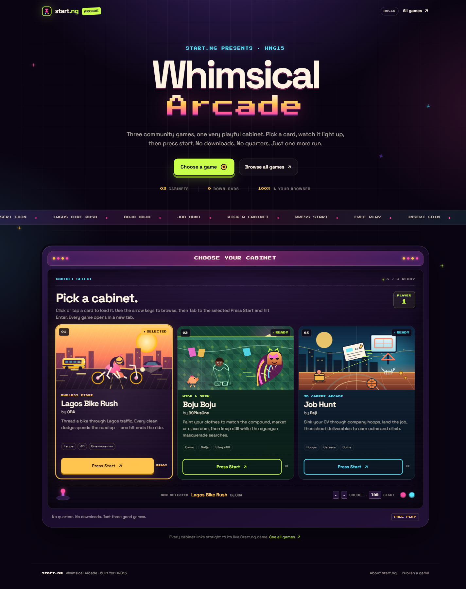
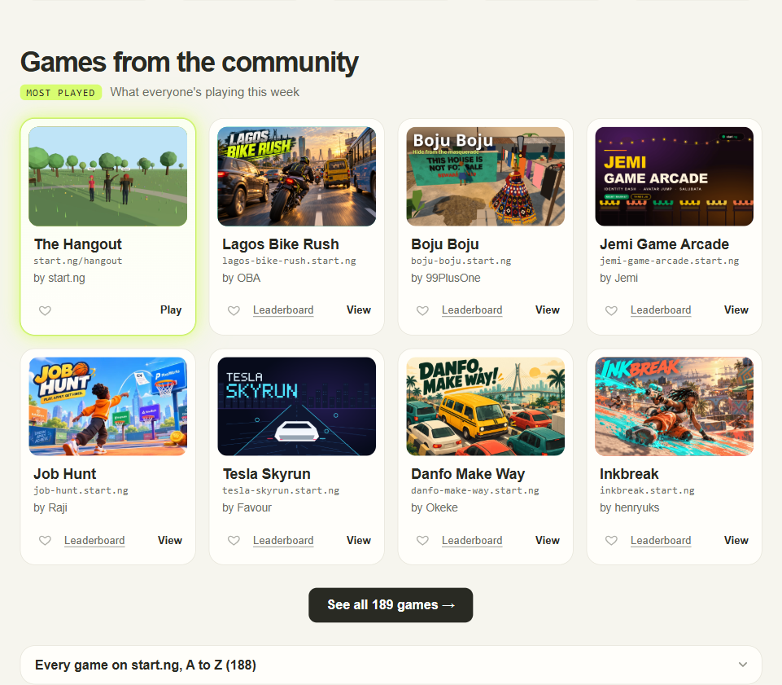

# Start.ng Whimsical Arcade

A playful, single-page redesign of the Start.ng community games section, built for **HNG15 Week 5, Task 2**. Three hand-picked browser games become three arcade cabinets: pick a card, watch it light up, then press start.



## The task

Redesign one existing Start.ng section as a whimsical, interactive experience. The page must feature **exactly three games**, and each card must show:

- the game title and creator;
- an original decorative visual;
- a clear selected state;
- a working **Press Start** link to the live game.

The experience also has to work with a mouse, touch and keyboard, respect reduced-motion preferences, and stay responsive from 320px upwards. No backend, authentication, leaderboards, payments, extra games, embedded mini-games, audio or unrelated pages.

## The original element

The source is the **“Games from the community”** section on [start.ng](https://start.ng/games) — a light card grid headed *“What everyone’s playing this week”*. Each card combines a game thumbnail, title, `game.start.ng` URL, creator and Play/Leaderboard/View actions.



The baseline was captured on 28 October 2026 and is kept for comparison only. No Start.ng artwork, game thumbnails or production assets are reused.

## What changed

| Original | Redesign |
| --- | --- |
| Light catalogue grid with many games | Dark arcade-cabinet shell with exactly three curated cabinets |
| Card thumbnail supplied by Start.ng | Original inline SVG scene drawn for each game |
| Separate Play / View / Leaderboard links | One clear **Press Start** action per cabinet |
| No persistent selection treatment | Selected cabinet lights up, changes status, announces itself and plays its own illustration reaction |
| Mouse-first browsing | Radio-group selection with wrapping arrow keys, Home/End, touch and pointer support |
| Standard page chrome | Marquee, cabinet bulbs, joystick, player readout and pixel typography |

The page keeps the useful parts of the original — title, creator, artwork and a direct route to play — while changing the presentation from a catalogue to a **cabinet select screen**. That felt like the most natural playful metaphor for “choose one of three games”, and it gives the page a single job instead of recreating the whole Start.ng catalogue.

The redesign is intentionally a tribute, not a Start.ng clone: it does not reproduce the site navigation, game library, leaderboard or account flows.

## The three cabinets

| # | Game | Creator | Genre | Live game | Accent |
| --- | --- | --- | --- | --- | --- |
| 01 | **Lagos Bike Rush** | OBA | Endless rider | [lagos-bike-rush.start.ng](https://lagos-bike-rush.start.ng/) | Amber / sunset |
| 02 | **Boju Boju** | 99PlusOne | Hide & seek | [boju-boju.start.ng](https://boju-boju.start.ng/) | Lime / patterned green |
| 03 | **Job Hunt** | Raji | 3D career arcade | [job-hunt.start.ng](https://job-hunt.start.ng/) | Cyan / night court |

Titles, creators and URLs were checked against the live Start.ng listing on **28 October 2026**; all three links returned **HTTP 200**. The catalogue lives in one place, [`src/data/games.ts`](src/data/games.ts), and tests assert that it contains exactly these three entries in this order.

## Design rationale

- **Cabinet select, not a shop window.** The brief asked for an arcade, so the page is framed as a physical cabinet: marquee, screen, joystick and player badge. Selecting a card is the “insert coin” moment, and Press Start is the only action.
- **Three distinct worlds.** Each cabinet has its own accent colour and an original SVG scene tied to the game’s premise:
  - *Lagos Bike Rush* — a rider threading a danfo, bus and skyline at sunset.
  - *Boju Boju* — a patterned compound, a hiding player and an egungun masquerade.
  - *Job Hunt* — a CV sailing through a hoop above a night basketball court.
- **A selected state you cannot miss.** Selection changes the border, glow, status chip, cabinet footer label and the “Now selected” readout. When motion is allowed, the bike scoots, the hidden player peeks, or the CV attempts a near-miss shot. The state is also exposed through the native radio.
- **Retro type, modern body copy.** Press Start 2P is reserved for small pixel labels; Space Grotesk carries the headings and descriptions so the cards remain readable.
- **Restrained motion.** Lift, tilt, marquee, bulbs and finite SVG selection reactions are all CSS. There is no canvas, particle engine or audio.

Palette: near-black purple (`#0a0412`), cream (`#fff4e3`), lime (`#c9ff4a`), pink (`#ff4fa3`), cyan (`#55e7ff`) and gold (`#ffc44d`).

## Interactions

- **Hover (mouse/fine pointer):** the card lifts, tilts slightly toward the pointer and follows it with a soft spotlight.
- **Click or tap:** selects the cabinet, updates every selected treatment and announces the choice through a polite live region.
- **Selection reaction:** Lagos Bike Rush anticipates, scoots and settles in 650ms; Boju Boju gives a shy head peek and pupil glance in 800ms; Job Hunt sends its CV on a near-miss arc and back in 900ms. There is no reaction on initial load or focus. Switching cabinets cancels the previous reaction.
- **Re-select:** tapping the already-selected cabinet replays its illustration reaction — a small “one more go” flourish.
- **Press Start:** opens that cabinet’s live game in a new tab with `rel="noopener noreferrer"`.
- **Keyboard:** Tab enters the radio group; arrow keys move and select with wrapping; Home/End jump to the first/last cabinet. Tab then moves to the **selected** cabinet’s Press Start link, and Enter launches it. Unselected Press Start links are removed from the tab order.
- **Reduced motion:** the marquee, bulb blink, sparks, hover lift/tilt, entrance reveals and selection reactions are all disabled. The preference is read live, so changing it mid-session cancels a reaction immediately. Restoring motion does not replay an old reaction.
- **Ambient motion timeout:** the decorative marquee, blinking bulbs, pulsing status dots and floating sparks automatically stop after 4.5 seconds. Selection, hover and short interaction animations continue to work.
- **Touch:** tapping the card body selects it; pointer tilt only runs for mouse input.

## Accessibility

- Native `<fieldset>` + `<legend>` radio group, so selection works without custom ARIA state.
- Each radio has the accessible name **“Game title by Creator”**.
- Visible focus rings and a first-stop **Skip to the games** link.
- Semantic landmarks (`header`, `main`, `footer`), one `h1`, and a labelled `h2` for the cabinet section.
- Selected state is conveyed by text (status chip, “Now selected” readout, `READY`) as well as colour and border.
- A polite live region announces “*Game* by *Creator* selected. Press Start to play.”
- External links include “(opens in a new tab)” for screen-reader users.
- Nonessential continuous motion stops automatically within five seconds, so no pause control is needed for the decorative marquee or blinking bulbs.
- Primary cream-on-ink text and accent labels were chosen for high contrast on their dark surfaces; focus indicators use the lime accent.
- No horizontal overflow at 320px; the layout stacks to one column below 720px and uses three columns from 720px.

## Tech stack

- **React 19** + **TypeScript 7**
- **Vite 8**
- **Tailwind CSS 4** (theme tokens plus component CSS in `src/index.css`)
- **Fontsource** for self-hosted Space Grotesk and Press Start 2P — no runtime font CDN
- **Font notices** for both OFL families are shipped at `public/licenses/` and copied into `dist/licenses/`
- **Vitest 5**, **Testing Library** and **jsdom** for tests
- **Oxlint** for linting

## Commands

Requires Node.js 20.19+ or 22.12+ (Vite 8).

```bash
npm install       # install dependencies
npm run dev       # start the Vite dev server
npm run build     # type-check and build to dist/
npm run preview   # serve the production build locally
npm run lint      # Oxlint
npm run typecheck # TypeScript project build
npm test          # Vitest, single run
npm run test:coverage
npm run check     # lint + typecheck + test + build
```

## Testing

`npm run check` was run on **28 October 2026** and passed end to end:

```text
lint       oxlint: passed
typecheck  tsc -b: passed
test       2 files, 21 tests passed
build      vite build: passed
```

The 21 tests cover:

- exactly three approved games, creators and URLs;
- unique, correctly shaped Start.ng links and required card content;
- three radios with the correct accessible names and first-game default;
- correct `href`, `target="_blank"` and `rel` on every Press Start;
- pointer selection, selected-card styling and live announcement;
- touch-style tap on card content;
- illustration replay when the selected card is tapped again;
- no reaction on load or focus, one event per selection, and stable SVG definitions and radio controls;
- previous-reaction cancellation during keyboard selection and immediate Press Start without replay;
- wrapping arrow navigation, Home/End and the roving Press Start tab stop;
- launching the selected game with Enter;
- every Press Start URL;
- the named fieldset, shared instructions and skip link;
- ambient motion stopping within five seconds;
- reduced motion at load, live cancellation, no stale replay when motion returns, and a `matchMedia`-less fallback.

### Browser checks

Playwright was used against the local production preview at **1440px, 768px and 320px**:

- three columns at 1440/768, one column at 320 with no horizontal scroll;
- hover lift/tilt and pointer spotlight;
- selection changes `data-selected`, border/glow, status text and “Now selected” readout;
- tap selects on a 320px viewport;
- arrow keys wrap and update selection; Enter opened `https://job-hunt.start.ng/`;
- focus ring visible on the selected Press Start;
- touchscreen taps and scrolling at 320px;
- ambient animations stopped after five seconds while selection still animated;
- emulated reduced motion produced `main[data-motion="reduced"]`, stopped the marquee and suppressed the burst.

## Screenshots and evidence

These screenshots document the original release, before game-specific selection reactions replaced the generic burst.

| Screenshot | What it shows |
| --- | --- |
| [`startng-community-games-baseline.png`](docs/screenshots/startng-community-games-baseline.png) | Original Start.ng community games section |
| [`arcade-desktop-1440.png`](docs/screenshots/arcade-desktop-1440.png) | Full desktop page, Lagos Bike Rush selected |
| [`arcade-selected-job-hunt.png`](docs/screenshots/arcade-selected-job-hunt.png) | Job Hunt selected, with cyan highlight and “GO!” burst |
| [`arcade-tablet-768.png`](docs/screenshots/arcade-tablet-768.png) | Three-column tablet layout |
| [`arcade-mobile-320.png`](docs/screenshots/arcade-mobile-320.png) | Single-column 320px layout |

Additional reduced-motion, touch, focus and accessibility-snapshot evidence is stored in the gitignored `.codex/` folder alongside the implementation and remediation reports.

## Project structure

```text
src/
  App.tsx                        page shell, radio state, keyboard logic, live region
  components/
    GameCard.tsx                 selectable cabinet, Press Start, tilt and reaction gating
    GameArtwork.tsx              three original inline SVG scenes and keyed moving groups
  data/
    games.ts                     single source of truth for the three games
    games.test.ts                catalogue and link validation
  hooks/
    usePrefersReducedMotion.ts   live media-query subscription
  test/
    matchMedia.ts                controllable matchMedia stub
    setup.ts                     Testing Library setup
  App.test.tsx                   interaction and accessibility tests
  index.css                      Tailwind theme + arcade styling
docs/screenshots/                review evidence
public/licenses/                 exact OFL notices for both font families
```

## Inspiration and attribution

- The task, the Start.ng name and the three games belong to **Start.ng** and their creators: **OBA** (*Lagos Bike Rush*), **99PlusOne** (*Boju Boju*) and **Raji** (*Job Hunt*). This is an unaffiliated design exercise.
- The cabinet metaphor is inspired by classic upright arcade machines; the marquee, bulbs, joystick and pixel labels are original CSS/SVG work.
- All three game scenes were drawn from scratch as inline SVG for this task. No Start.ng thumbnails, logos or game assets are copied.
- Space Grotesk and Press Start 2P are self-hosted through Fontsource under the SIL Open Font License. The exact upstream copyright and license texts are shipped in `public/licenses/` and included in the production build.

### Font licenses

- **Press Start 2P** — Copyright 2012 The Press Start 2P Project Authors (cody@zone38.net), with Reserved Font Name “Press Start 2P”. Full SIL OFL 1.1 text: [`public/licenses/Press-Start-2P-OFL.txt`](public/licenses/Press-Start-2P-OFL.txt), served at `/licenses/Press-Start-2P-OFL.txt`.
- **Space Grotesk** — Copyright 2020 The Space Grotesk Project Authors (https://github.com/floriankarsten/space-grotesk). Full SIL OFL 1.1 text: [`public/licenses/Space-Grotesk-OFL.txt`](public/licenses/Space-Grotesk-OFL.txt), served at `/licenses/Space-Grotesk-OFL.txt`.

## Deployment

**Nothing has been committed, pushed or deployed.** This workspace is not a Git repository, and the task stopped at local review.

The output is a static site. To deploy later:

```bash
npm ci
npm run check
npm run build
# upload the contents of dist/ to any static host
```

There is no client-side routing, so no SPA rewrite rules are required. Vercel, Netlify, GitHub Pages or any static file host can serve `dist/`.

## Known limitations

- The games are hosted by Start.ng and open in a new tab; this page does not embed or reimplement them. A game being offline would be an external failure.
- The selected cabinet resets to Lagos Bike Rush on reload because there is no backend or persistence requirement.
- The page deliberately ships no audio, leaderboard, authentication or extra pages.
- Link and metadata checks reflect the live Start.ng state on 28 October 2026.

---

Built for **HNG15 Week 5, Task 2**. Local implementation report: `.codex/TASK2_IMPLEMENTATION_REPORT.md` (gitignored).
